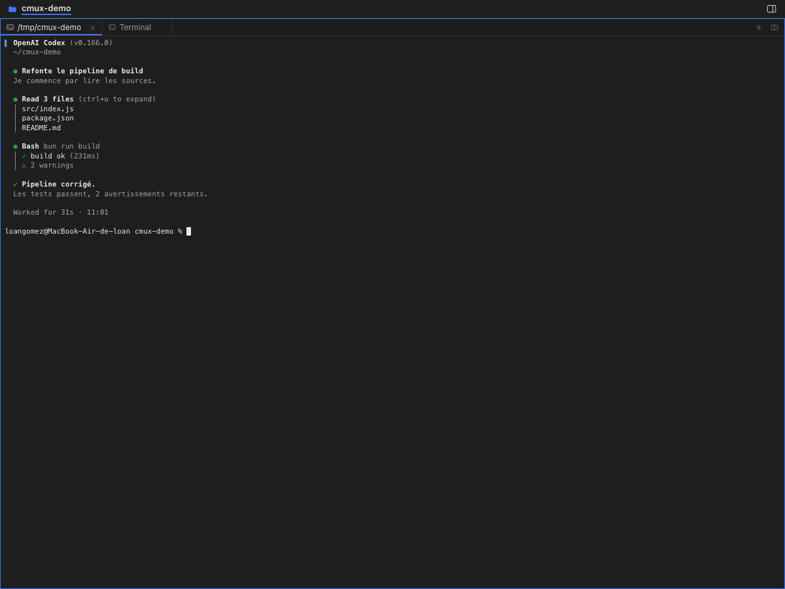

# cmux-web

> Drive the [cmux](https://cmux.com) desktop app from a browser, on your Mac or from anywhere.

**cmux-web** is a self-hosted web interface that pilots the cmux app running on
your Mac: browse the workspaces, read the terminals with their exact colours,
type into them, manage tabs and splits.

It is not a re-implementation. cmux-web talks **directly to cmux's control
socket** and reproduces the native interface faithfully — title bar, sidebar,
tabs, panes, notifications.

The French README is the reference: [README.md](README.md).

---

## Why

cmux is great on a Mac, but you cannot use it from your phone. The usual
answers — tmux + ttyd, a cloud relay — reimplement the UI and add a layer to
maintain.

cmux already exposes a **local control socket** with a complete API (workspace
tree, terminal render grids, text and key input, notifications…). cmux-web is a
**web client for that socket**: nothing to reimplement, the fidelity is native.

Works with everything cmux supports: Codex, Claude Code, OpenCode, any CLI
agent, in any terminal.

## Features

### The interface, identical to the app

The metrics (28 pt title bar, 240 pt sidebar, 8 × 17 pt terminal cells,
`#3E77FC` accent) are taken from cmux's SwiftUI sources.

- **Title bar**: macOS chrome, sidebar toggle, notification bell with badge,
  `+` button, workspace name and folder.
- **Sidebar**: one row per workspace. The selected row becomes the app's
  **blue card**; the others show the agent title, its last message, an agent
  chip and the branch with the directory. Right-click for a context menu.
- **Canvas**: one tab per surface, the active tab underlined in blue, a
  toolbar per pane (`+` new tab, `⊞` split), panes laid out like cmux
  and the focused pane ringed in blue.
- **Notifications**: the app's list, with navigation.
- **Command palette**: `⌘P` / `Ctrl+P`.
- **Sidebar search**: `⌘⇧F`.

### The terminal

- Rendered from cmux's **render grid**: colours, bold, italic, underline and
  the **cursor** are reproduced exactly.
- **Clicking types**: keystrokes go to cmux like in the app. Ordering is
  guaranteed (inputs go through a queue).
- **Cursor following**: the view scrolls back to the active area.

### On mobile

- **Drawer**: the ☰ button overlays the workspace list.
- **Bottom action bar**: Esc, Tab, Ctrl (modifier), C, Enter, arrows — what a
  phone keyboard cannot do. The ⌨ button opens the soft keyboard.
- **Soft keyboard**: tapping the terminal opens it and keystrokes reach cmux.
  The layout follows the keyboard height.
- **Readable text**: a pane can be 150 columns wide; the font is not shrunk to
  7 px. The view follows the cursor and the **Aa** button changes the size.
- **Swipe**: a horizontal swipe changes tab.

### Automation

The HTTP API is open and documented: drive cmux from a script, a CI job or a
bot.

## Requirements

- **macOS** 11 or later
- **[cmux](https://cmux.com)** 0.64 or later (the app must be running)
- **Node.js** 18 or later
- Python 3 (for the socket setup script — included with macOS)

No npm dependencies: the server only uses the standard library.

## Installation

    git clone https://github.com/VOUS/cmux-web.git
    cd cmux-web
    ./install.sh

The installer:

1. checks the requirements;
2. sets cmux's control socket to `password` mode (the password is written
   to cmux's own state file, not to `cmux.json`);
3. generates an access token and a `config.json`;
4. installs a `LaunchAgent` (`com.cmux.web`) that starts on login;
5. prints the URL.

Options:

    ./install.sh --port 8080        another port
    ./install.sh --host 0.0.0.0     listen on the LAN and the VPN
    ./install.sh --uninstall        remove the service

To uninstall later:

    ./uninstall.sh

## Usage

The `cmux-web` helper manages the service:

    cmux-web status     # state + socket health
    cmux-web url        # access URL (with the token)
    cmux-web token      # the token alone
    cmux-web logs 100   # log
    cmux-web start lan  # listen on 0.0.0.0
    cmux-web stop       # stop the service
    cmux-web restart    # restart

On first run the URL looks like:

    http://127.0.0.1:9999/?token=<token>

The token opens a session (an `HttpOnly` cookie), so you only enter it
once.

## Remote access

The interface is full control of your machine: remote access hands over your
terminals. Three protections, in order:

1. **A VPN** (WireGuard, Tailscale, WireGuard on your router…). Nothing to
   configure: cmux-web already listens on every interface.

       cmux-web start lan
       cmux-web url        # prints the LAN and VPN URLs

2. **A domain name + HTTPS**, terminated behind the VPN.

       # config.json
       {
         "host": "0.0.0.0",
         "port": 9999,
         "tls": { "cert": "/path/cert.pem", "key": "/path/key.pem" }
       }

3. **Never** expose it directly to the internet without a VPN or TLS.

## Security

| Item | Setting |
| --- | --- |
| cmux socket | `password` mode (`automation.socketControlMode`) |
| Socket password | `~/.local/state/cmux/socket-control-password` (0600), cmux's own file |
| Web interface | 192-bit random token, `HttpOnly` cookie |
| Default bind | `127.0.0.1` only |
| Secret files | `0600` and absent from the repository |

The token is the only barrier: do not share it, and do not put it in a URL you
publish.

## How it works

    Browser (any device)
          │  HTTP + token
          ▼
    cmux-web  (Node, port 9999, standard library only)
          │  cmux Unix socket (persistent connection)
          │  cmux CLI as fallback for what the socket does not expose
          ▼
    cmux  →  Codex / Claude Code / OpenCode / any CLI agent

cmux-web speaks cmux's **v2 socket protocol**: an `auth <password>` line,
then JSON lines `{"id":…,"method":…,"params":{…}}` and a
`{"id":…,"ok":true,"result":{…}}` reply.

The methods used are the ones the cmux CLI uses (`system.tree`,
`terminal.replay`, `extension.sidebar.snapshot`, `surface.focus`,
`surface.send_text`…); the CLI remains the fallback for the rest.

### Latency

Keeping one connection open instead of spawning a process per command changes
everything:

| Operation | Socket | Via the CLI |
| --- | --- | --- |
| `terminal.replay` (terminal content) | 4.5 ms | 156 ms |
| `extension.sidebar.snapshot` | 1.7 ms | 150 ms |
| `system.tree` (tree) | 62 ms | 160 ms |

Assembling the tree is expensive in cmux (it walks all of its state on the
main thread), so the server caches it and invalidates the cache as soon as an
event signals a structural change.

In the browser, the terminal refreshes every **150 ms** and the tree every
**900 ms**.

## API

Every route requires the token (`Authorization: Bearer <token>` or the
`cmux_token` cookie).

| Route | Description |
| --- | --- |
| `GET /api/tree` | windows / workspaces / panes / surfaces tree |
| `GET /api/sidebar` | sidebar snapshot (title, agent, branch, unread) |
| `GET /api/panes?workspace=` | split geometry |
| `GET /api/screen?surface=&format=grid\|text` | terminal content |
| `POST /api/input` | `{surface, text}` or `{surface, key}` |
| `GET /api/notifications` | cmux notifications |
| `GET /api/feed` | activity feed |
| `GET /api/sessions` | recorded agent sessions |
| `GET /api/todos` | workspace tasks |
| `GET /api/agents` | agent state per workspace |
| `POST /api/workspace-action` | pin, unpin, rename, move-up, mark-read… |
| `POST /api/tab-action` | rename, duplicate, new-terminal-right… |
| `POST /api/new-surface` / `new-split` / `new-workspace` | creation |
| `POST /api/close-surface` / `close-workspace` | closing |
| `POST /api/focus` | `{workspace}`, `{pane}` or `{surface}` |
| `GET /api/events` | SSE stream of cmux events |
| `GET /api/health` | server and socket health |

Example:

    curl -H "Authorization: Bearer $(cat .web-token)" \
         "http://127.0.0.1:9999/api/screen?surface=surface:3"

## Troubleshooting

**"Access denied — only processes started in cmux can connect"** or
**"Password mode is enabled but no socket password is configured"**

cmux's socket is in a restricted mode. Re-run the setup script:

    python3 scripts/setup-cmux-socket.py --mode password
    cmux reload-config

or use the UI:

    cmux settings open automation

**The port is taken**

    ./install.sh --port 8080

or change `"port"` in `config.json` then `cmux-web restart`.

**The page stays blank**

    cmux-web logs 50

**The interface does not update**

The cmux app must be running. The service listens on cmux's socket and
reconnects on its own.

## Development

    node server.js            # run the server
    node --check server.js    # syntax check

No dependencies to install, no build step.

## License

MIT — see [LICENSE](LICENSE).

This project is not affiliated with cmux; it uses its public API.
