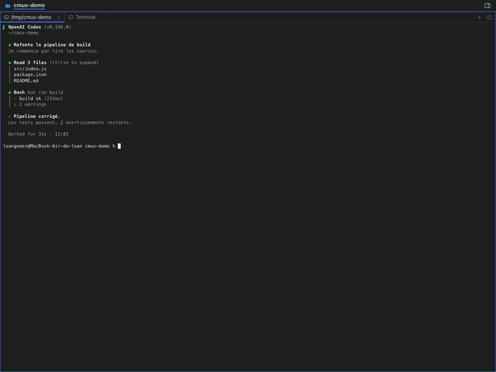
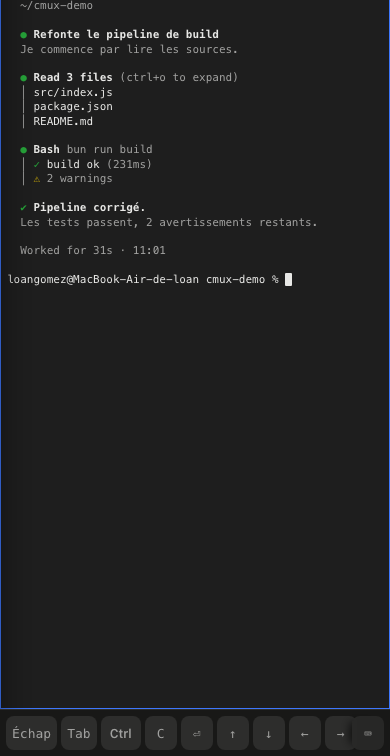

# cmux-web

> Pilotez l'application [cmux](https://cmux.com) depuis un navigateur, sur votre Mac ou à distance.

**cmux-web** est une interface web auto-hébergée qui pilote l'application cmux
installée sur votre Mac : on voit les workspaces, on lit les terminaux avec
leurs couleurs exactes, on tape dedans, on gère les onglets et les splits.

Ce n'est pas une réimplémentation : cmux-web parle **directement au socket de
contrôle de cmux** et restitue fidèlement l'interface de l'application —
barre de titre, sidebar, onglets, panneaux, notifications.

---

## Table des matières

- [Pourquoi](#pourquoi)
- [Captures](#captures)
- [Fonctionnalités](#fonctionnalités)
- [Prérequis](#prérequis)
- [Installation](#installation)
- [Utilisation](#utilisation)
- [Accès à distance](#accès-à-distance)
- [Sécurité](#sécurité)
- [Comment ça marche](#comment-ça-marche)
- [API](#api)
- [Dépannage](#dépannage)
- [Licence](#licence)

---

## Pourquoi

L'application cmux est formidable sur le Mac, mais on ne peut pas l'utiliser
depuis son téléphone. Les solutions habituelles — tmux + ttyd, un relais dans
le cloud — soupsent l'interface et ajoutent une couche à maintenir.

cmux expose déjà un **socket de contrôle local** avec une API complète
(arbre des workspaces, grille de rendu des terminaux, envoi de texte et de
touches, notifications…). cmux-web est un **client web de ce socket** : rien à
réimplémenter, la fidélité est-native.

Compatible avec tout ce que cmux sait faire : Codex, Claude Code, OpenCode,
n'importe quel agent en CLI, dans n'importe quel terminal.

## Captures

| Desktop | Mobile |
| --- | --- |
|  |  |

## Fonctionnalités

### L'interface, à l'identique de l'app

Les valeurs (barre de titre 28 pt, sidebar 240 pt, cellules de terminal
8 × 17 pt, accent `#3E77FC`) sont relevées dans le code SwiftUI de cmux.

- **Barre de titre** : chrome macOS, bascule de la sidebar, cloche de
  notification avec pastille, bouton `+`, nom du workspace et son dossier.
- **Sidebar** : une ligne par workspace. La ligne sélectionnée devient la
  **carte bleue** de l'application ; les autres affichent le titre de l'agent,
  son dernier message, une puce d'agent et la branche avec le dossier.
  Clic droit = menu contextuel (renommer, épingler, description, monter,
  descendre, fermer).
- **Canvas** : un onglet par surface avec l'onglet actif souligné en bleu,
  une barre d'outils par panneau (`+` nouvel onglet, `⊞` diviser), les
  panneaux disposés comme dans cmux et le panneau focalisé cerclé de bleu.
- **Notifications** : la liste de l'application, avec navigation.
- **Palette de commandes** : `⌘P` / `Ctrl+P`.
- **Recherche de sidebar** : `⌘⇧F`.

### Le terminal

- Rendu depuis la **grille de cmux** : couleurs, gras, italique, souligné et
  **curseur** sont reproduits à l'identique.
- **Le clic saisit au clavier** : les frappes partent vers cmux comme dans
  l'app. L'ordre est garanti (les entrées passent par une file).
- **Suivi du curseur** : la vue recule automatiquement vers la zone active.

### Sur mobile

- **Tiroir** : le bouton ☰ ouvre la liste des workspaces en surimpression.
- **Barre d'actions basse** : Échap, Tab, Ctrl (modificateur), C, Entrée,
  flèches — ce que le clavier d'un téléphone ne sait pas faire. Le bouton ⌨
  ouvre le pavé logiciel.
- **Clavier logiciel** : un appui sur le terminal l'ouvre et les frappes
  partent vers cmux. La mise en page suit la hauteur du clavier.
- **Texte lisible** : un pane peut faire 150 colonnes ; on ne réduit pas la
  police à 7 px. La vue suit le curseur et le bouton **Aa** change la taille.
- **Swipe** : un balayage horizontal change d'onglet.

### Automatisation

L'API HTTP est ouverte et documentée : on peut piloter cmux depuis un script,
une CI ou un bot.

## Prérequis

- **macOS** 11 ou plus
- **[cmux](https://cmux.com)** 0.64 ou plus (l'application doit tourner)
- **Node.js** 18 ou plus
- Python 3 (pour le script de configuration du socket — présent par défaut
  sur macOS)

Aucune dépendance npm : le serveur n'utilise que la bibliothèque standard.

## Installation

    git clone https://github.com/VOUS/cmux-web.git
    cd cmux-web
    ./install.sh

L'installeur :

1. vérifie les prérequis ;
2. configure le socket de contrôle de cmux en mode `password` (le mot de
   passe est écrit dans le fichier d'état de cmux, pas dans `cmux.json`) ;
3. génère un jeton d'accès et un `config.json` ;
4. installe un `LaunchAgent` (`com.cmux.web`) qui démarre le service
   à l'ouverture de session ;
5. affiche l'URL d'accès.

Options :

    ./install.sh --port 8080        autre port
    ./install.sh --host 0.0.0.0     écoute sur le LAN et le VPN
    ./install.sh --uninstall        désinstalle le service

Pour désinstaller ensuite :

    ./uninstall.sh

## Utilisation

La commande `cmux-web` est un utilitaire de gestion du service :

    cmux-web status     # état + santé du socket
    cmux-web url        # URL d'accès (avec le jeton)
    cmux-web token      # jeton seul
    cmux-web logs 100   # journal
    cmux-web start lan  # passe en écoute sur 0.0.0.0
    cmux-web stop       # arrête le service
    cmux-web restart    # redémarre

Au premier lancement, l'URL est de la forme :

    http://127.0.0.1:9999/?token=<jeton>

Le jeton ouvre une session (cookie `HttpOnly`) : on n'a plus à le saisir.

## Accès à distance

L'interface est un contrôle total de votre machine : un accès distant donne
la main sur vos terminaux. Trois protections, dans cet ordre :

1. **Un VPN** (WireGuard, Tailscale, WireGuard sur votre box…). Rien à
   configurer : cmux-web écoute déjà sur toutes les interfaces.

       cmux-web start lan
       cmux-web url        # affiche l'URL LAN et l'URL VPN

2. **Un nom de domaine + HTTPS**, terminé derrière le VPN.

       # config.json
       {
         "host": "0.0.0.0",
         "port": 9999,
         "tls": { "cert": "/chemin/cert.pem", "key": "/chemin/cle.pem" }
       }

3. **Jamais** l'exposition directe sur Internet sans VPN ni TLS.

## Sécurité

| Élément | Réglage |
| --- | --- |
| Socket cmux | mode `password` (`automation.socketControlMode`) |
| Mot de passe du socket | `~/.local/state/cmux/socket-control-password` (0600), le fichier de cmux lui-même |
| Interface web | jeton aléatoire de 192 bits, cookie `HttpOnly` |
| Écoute par défaut | `127.0.0.1` uniquement |
| Fichiers de secrets | `0600` et absents du dépôt |

Le jeton est la seule barrière : ne le partagez pas, et ne le mettez pas dans une
URL que vous publiez.

## Comment ça marche

    Navigateur (n'importe quel appareil)
          │  HTTP + jeton
          ▼
    cmux-web  (Node, port 9999, bibliothèque standard uniquement)
          │  socket Unix de cmux (connexion permanente)
          │  cmux CLI en repli pour ce que le socket n'expose pas
          ▼
    cmux  →  Codex / Claude Code / OpenCode / n'importe quel agent en CLI

cmux-web parle le **protocole v2** du socket de cmux : une ligne
`auth <mot de passe>`, puis des lignes JSON
`{"id":…,"method":…,"params":{…}}` et une réponse
`{"id":…,"ok":true,"result":{…}}`.

Les méthodes utilisées sont les mêmes que celles du CLI cmux
(`system.tree`, `terminal.replay`, `extension.sidebar.snapshot`,
`surface.focus`, `surface.send_text`…) ; le CLI reste le repli pour le
reste.

### Latence

Garder une connexion ouverte au lieu de relancer un processus à chaque
commande change tout :

| Opération | Socket | Via le CLI |
| --- | --- | --- |
| `terminal.replay` (contenu du terminal) | 4,5 ms | 156 ms |
| `extension.sidebar.snapshot` | 1,7 ms | 150 ms |
| `system.tree` (arborescence) | 62 ms | 160 ms |

Assembler l'arborescence est coûteux dans cmux (parcours de tout son état sur
le thread principal) : le serveur la met en cache et l'invalide dès qu'un
événement signale un changement de structure.

Côté navigateur, le terminal est rafraîchi toutes les **150 ms** et
l'arborescence toutes les **900 ms**.

## API

Toutes les routes exigent le jeton (`Authorization: Bearer <token>` ou
cookie `cmux_token`).

| Route | Description |
| --- | --- |
| `GET /api/tree` | arborescence windows / workspaces / panes / surfaces |
| `GET /api/sidebar` | snapshot de la sidebar (titre, agent, branche, unread) |
| `GET /api/panes?workspace=` | géométrie des splits |
| `GET /api/screen?surface=&format=grid\|text` | contenu du terminal |
| `POST /api/input` | `{surface, text}` ou `{surface, key}` |
| `GET /api/notifications` | notifications cmux |
| `GET /api/feed` | flux d'activité |
| `GET /api/sessions` | sessions d'agents enregistrées |
| `GET /api/todos` | tâches du workspace |
| `GET /api/agents` | état des agents par workspace |
| `POST /api/workspace-action` | pin, unpin, rename, move-up, mark-read… |
| `POST /api/tab-action` | rename, duplicate, new-terminal-right… |
| `POST /api/new-surface` / `new-split` / `new-workspace` | création |
| `POST /api/close-surface` / `close-workspace` | fermeture |
| `POST /api/focus` | `{workspace}`, `{pane}` ou `{surface}` |
| `GET /api/events` | flux SSE des événements cmux |
| `GET /api/health` | état du serveur et du socket |

Exemple :

    curl -H "Authorization: Bearer $(cat .web-token)" \
         "http://127.0.0.1:9999/api/screen?surface=surface:3"

## Dépannage

**« Accès refusé — seuls les processus démarrés dans cmux peuvent se
connecter »** ou **« Password mode is enabled but no socket password is
configured »**

Le socket de cmux est en mode restreint. Rejouez le script de configuration :

    python3 scripts/setup-cmux-socket.py --mode password
    cmux reload-config

ou passez par l'interface :

    cmux settings open automation

**Le port est déjà pris**

    ./install.sh --port 8080

ou changez `"port"` dans `config.json` puis `cmux-web restart`.

**La page reste blanche**

Vérifiez le journal :

    cmux-web logs 50

**L'interface ne se met pas à jour**

L'application cmux doit tourner. Le service écoute le socket de cmux ; si
cmux est quitté, le service se reconnecte automatiquement au lancement suivant.

## Développement

    node server.js            # lance le serveur en avant-première
    node --check server.js    # vérifie la syntaxe

Aucune dépendance à installer, aucun build.

## Licence

MIT — voir [LICENSE](LICENSE).

Ce projet n'est pas affilié à cmux ; il utilise son API publique.
